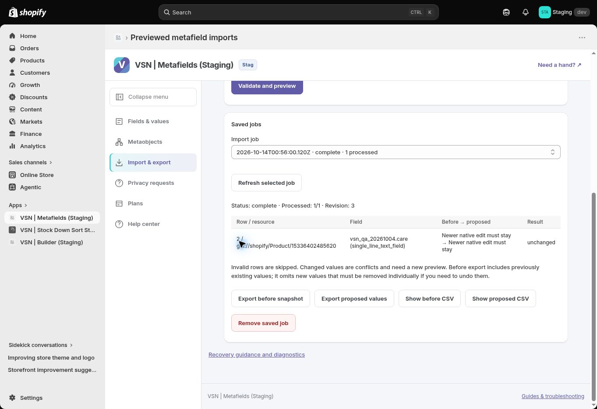

# Staging batch report — 2026-10-14

## Result

[PR #304](https://github.com/Vertex-Systems-Network/vsn-metafields/pull/304) fixed stale native import-job status labels and merged to development at `17f9395b6a27f96fb475edc008ee8dc46fcce314`. [Staging deploy #97](https://github.com/Vertex-Systems-Network/vsn-metafields/actions/runs/38491950164) succeeded for that workflow source. The actual post-deployment regression displayed `complete · 1 processed` in both selector and details, with `unchanged` result.

The batch is **partially verified**, with concrete remaining gates below. It is not full product completion. Live deployment and App Store submission remain unperformed.

## Completed checks

| Check | Actual result |
| --- | --- |
| Local dependencies / runtime | Fresh npm ci on Node 22.13.0 passed |
| Release checks | Lint, typecheck, DB model contract, 189/189 tests and build passed |
| Full dependency audit | Zero vulnerabilities at every severity; historical failed-audit blocker superseded |
| Fresh local SQLite | Three migrations applied; HTTP health displayed VSN Metafields Dev identity |
| PR CI | Integrity run #38491612899 and App Validation run #38491612989 passed |
| Staging runtime | Credential/Neon identity, migrations, Worker health/billing and Shopify session/subscription reads passed |
| Staging service acceptance | 51 schema documents, 21 typed values, stale-write rejection, definition retention, metaobject field preservation and bulk mixed/conflict/completed-resume/shop-isolation passed |
| Fixture cleanup | Complete disposable service cleanup; zero failures |
| Browser import | Original and post-fix identical one-row jobs completed 1/1 unchanged; updated selector label verified |
| Optional reference reads | Actual Page/File picker options returned; saved reference values reopened |
| Metaobjects / tier disclosure | QA definition and Draft entry reopened; Starter two-field cap and disabled public Pro option observed |
| Keyboard navigation | Collapsed Fields & values received Tab focus and tooltip; Escape dismissed tooltip without moving focus |
| Primary button | Measured contrast 5.86:1, height 40px |
| Retained Staging logs | Zero warning/error text matches in recorded 24-hour window |
| Manual Neon restore | PR #303 records matching tables/counts, unexpected endpoint reassignment and completed repair; temporary compute removed |

Local Dev health uses isolated SQLite and example credentials. It does not certify an installed Shopify Dev app. The workflow source report is not independent health commitSha attestation: [draft PR #298](https://github.com/Vertex-Systems-Network/vsn-metafields/pull/298) still requires independent review under repository path policy. Retained logs exclude automatic invocation logs and do not prove every-request outcomes or signed privacy delivery.

## Remaining gates

| Gate | Status / concrete limit |
| --- | --- |
| Mixed CSV browser Apply | Automatic approval review rejected preview be04d7884055 as a different payload from the approved one-row job. Text row is valid/unchanged; integer row invalid; preview remains 0/2. No workaround applied it. |
| CSV chooser / export download | Event interception timed out after 10 seconds. Actual upload/download unverified; visible CSV fallback available. |
| 200% / 320px / mobile / screen reader | Shortcut did not change viewport; browser policy denied settings access. No full reflow/mobile/assistive-technology pass. |
| Public metaobjects / actual tier transitions | Starter guard passed; real Pro transition/public confirmation path not performed. Financial approval remains a user action. |
| Full draft themes / lower-control images | On standby until prerequisite gates close, following requested order. Prior Horizon/Tinker smoke evidence retains its limited scope. |
| Fresh Shopify install | On standby; fresh local dependency/DB setup is a different check. |
| Signed matching privacy request / fulfillment | Requires a matching disposable request and actual delivery/fulfillment evidence; queued samples alone do not pass. |
| Backup cadence / recovery objectives / outage | Manual snapshot comparison passed; automatic schedule, measured RPO/RTO and operational ownership/assurance remain unverified. |
| Independent review / runtime SHA | PR #298 has no reviews; existing control-plane protection retained. |
| Official Shopify self-review | Pinned CLI doc fetch failed with EAI_AGAIN shopify.dev. Skill requires this canonical CLI fetch and forbids alternate retrieval, so no full self-review claimed. |
| Upstream notices | npm deprecations and Vite Environment API notice persist; fresh audit has no vulnerabilities. Browser provider/plugin notices were also observed. |
| Live production | Held by current user instruction; no production rollout, billing mutation or App Store submission. |

## All work units

Verified-complete work units: **3/12 (25%)**. Source, service and partial browser results are distinguished from full work-unit acceptance. Phase 04 remains 0/3.

| Work unit | Task | Plan status | Evidence / remaining boundary |
| --- | --- | --- | --- |
| META-001 | Pin API version and owner/type/scope/storefront matrix | complete | Accepted evidence already recorded. |
| META-002 | Decide namespace, access and migration | complete | Accepted evidence already recorded. |
| META-003 | Standard and custom definition lifecycle | complete | Accepted evidence already recorded. |
| META-004 | Type-aware value editor | verification_required | Staging QA on 2026-10-10: valid scalar and page/file references save, reload and clean up successfully; minimum-length validation rejects invalid input; stale-write conflict is confirmed in two concurrent staging tabs and preserves the newer saved reference. Remaining: invalid behavior across the broader supported type matrix and complete automated/end-to-end evidence; see docs/evidence/metafields-value-roundtrip-2026-10-10.json. |
| META-005 | Single Field block | verification_required | Horizon and Tinker unpublished drafts both render the configured public product metafield after saving/reloading. Tinker settings persist when entered through normal keyboard UI input. Manual two-theme render gate is met; remaining module-specific automated contract/end-to-end evidence must be reconciled before completion. See docs/evidence/metafields-tinker-theme-preview-2026-10-10.json. |
| META-006 | Specifications block | verification_required | Horizon and Tinker unpublished drafts both render the public Material value in Specifications after saving/reloading. Two-theme public-value rendering is verified. Reordering, multiple instances, full 45-setting usability and broader automated acceptance remain open. See docs/evidence/metafields-tinker-theme-preview-2026-10-10.json. |
| META-007 | Metaobject lifecycle | verification_required | Private QA definition saved/reopened; min-length error and valid Draft save/readback verified. Public-access confirmation, field-preservation and conflict flows remain required. |
| META-008 | Previewed bulk value operations | verification_required | Same-value one-row preview/apply/history completed on Staging; mixed preview separates valid/invalid rows. Mixed browser Apply rejected by automatic approval review; file chooser/export downloads unverified. Disposable service mixed/conflict/resume/isolation passed in deploy #97. |
| META-009 | Specialized typed storefront blocks | verification_required | All typed blocks registered and retained after Horizon draft save/reload; empty-source editor guidance observed. Real public Shopify filters/variant refresh/recovery in two themes remain required. |
| META-010 | Onboarding, permissions and diagnostics | verification_required | Staging title/menu/diagnostics remain verified. Local Dev HTTP health title and granted page/file picker readbacks verified on 2026-10-14. Installed Dev-app UI, lower-control screenshots, actual tier transitions and non-granted consent-session acceptance remain pending. |
| META-011 | Staging end-to-end and release preflight | in_progress | Node 22.13 release checks passed with 189 tests and zero full-tree audit vulnerabilities; Staging #97 service acceptance passed; manual Neon restore comparison verified. Remaining: exact runtime SHA (PR #298 independent review), full browser/theme/mobile/zoom/screen-reader/performance acceptance, representative signed privacy receipts/fulfillment, automated backup/RTO/RPO/outage and independent release assurance. |
| META-012 | Progressive production rollout | not_started | Separate production rollback certification and staging release gates |

[Machine-readable batch evidence](../evidence/metafields-staging-batch-2026-10-14.json). Relevant checkpoint and blockers were reconciled without closing incomplete work units.
