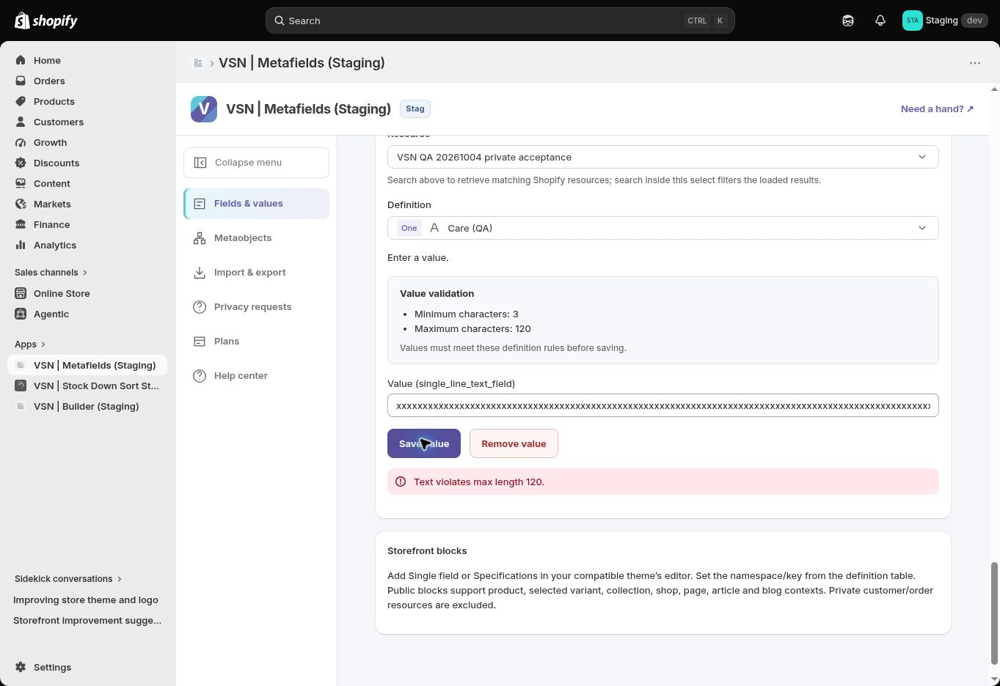
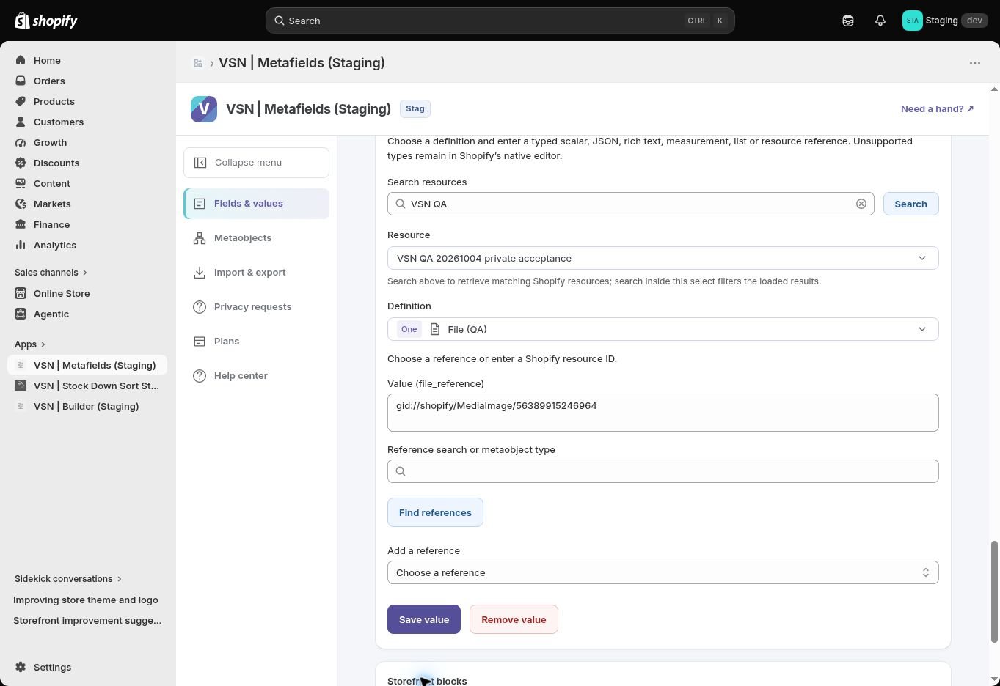

# Staging value feedback verification — 2026-10-14

A real editor defect was reproduced and fixed in [PR #307](https://github.com/Vertex-Systems-Network/vsn-metafields/pull/307): after an invalid File save, switching fields and returning to File displayed the discarded error beside the valid value freshly read from Shopify. The value action fetcher now resets whenever the owner, resource or definition changes.

[Staging deploy #98](https://github.com/Vertex-Systems-Network/vsn-metafields/actions/runs/38557844645) succeeded from `ccb748003d9310266e042c8e2a632a604c460f32`. Migration/isolation, Worker health, session/subscription and disposable metafield/metaobject/bulk lifecycle checks passed, including cleanup with no failures. Local Node 22.13 release checks passed lint, typecheck, database model contract, **189/189 tests** and build. Both PR CI checks passed. No Live deployment occurred.

| Browser subtask | Result |
|---|---|
| Integer `1.2` rejected | Pass; saved `0` preserved after field reselection |
| Care 121 characters rejected against max 120 | Pass; original text preserved |
| Product ID entered in Page field rejected | Pass; original Page reference preserved |
| Page ID entered in File field rejected | Pass; original MediaImage reference preserved |
| Error clears when selecting another field | Pass |
| Return to File after rejected attempt on fixed build | Pass; saved reference remains and discarded error does not reappear |

The post-deploy regression deliberately repeated the File rejection, selected Care, then returned to File. Its current rejection remained visible until leaving that editing context; the old error stayed absent after returning. These are representative browser cases, not full supported-type browser certification. [Machine evidence](../evidence/metafields-value-feedback-2026-10-14.json).

Retained Staging logs returned **0 warning/error text matches** in the recorded 30-minute window. Automatic invocation logging remains disabled; this does not certify every-request outcomes or signed privacy delivery. Staging retains the same ACTIVE Starter test subscription.

**Acceptance remains 3/12 (25%), Phase 04 0/3.** Full remaining tasks are listed in [the batch report](STAGING-BATCH-REPORT-2026-10-14.md). Exact runtime commit attestation still needs independent PR #298 review. Mixed browser Apply needs exact approval; file transfers, fresh Shopify install/full theme matrices in the requested sequence, actual tier/public-metaobject paths, accessibility/performance, matching signed privacy fulfillment, and backup/operational/independent assurance remain open. [Previous continuation](STAGING-CONTINUATION-2026-10-14.md) records the 46-type local invalid codec checks and checklist DNS blocker.
