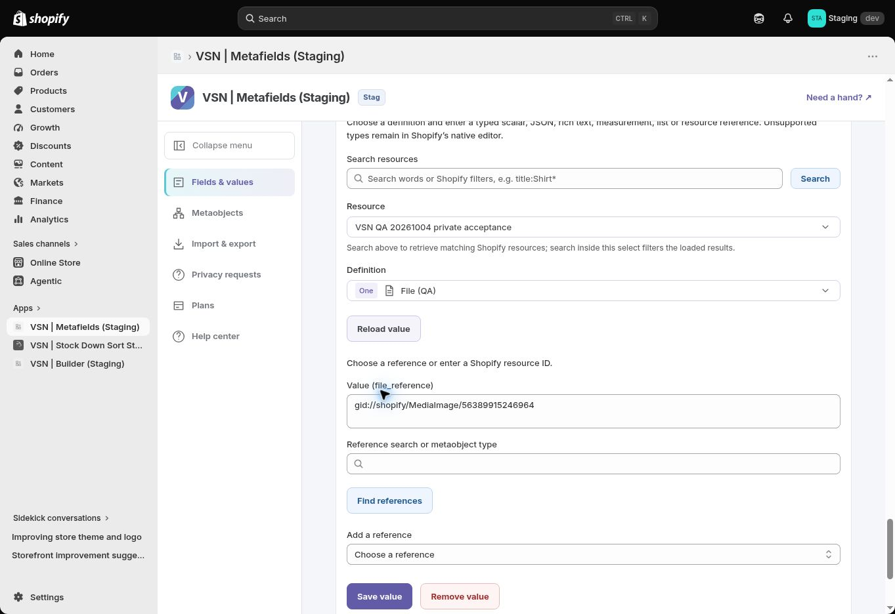

# Staging value reload recovery — 2026-10-14

[PR #309](https://github.com/Vertex-Systems-Network/vsn-metafields/pull/309) adds the **Reload value** control that the help guide described but the editor lacked. It clears old action feedback and reads the selected field's current saved value/digest. The control remains present after a lookup error and is disabled during a value read or mutation. It does not submit a Shopify write. Help labels now use the same control name.

[Staging #99](https://github.com/Vertex-Systems-Network/vsn-metafields/actions/runs/38561975085) passed from `8238390910868f3a8337f62d407ec29a88ab4ec7`: migrations/isolation, Worker health, sessions/subscription and disposable metafield/metaobject/bulk lifecycle, with cleanup and no failures. Local Node22.13 release checks and both feature PR CI checks passed; local release includes **189/189 tests**, lint, typecheck, model parity and build.

| Actual browser check | Result |
|---|---|
| Reload disabled during a value read, enabled when idle | Pass |
| Unsaved Page-ID draft replaced by the saved File MediaImage reference | Pass |
| Reload disabled while invalid Save request is running | Pass |
| Rejected File Save displays the reference-type error | Pass |
| Reload after rejection restores saved value and clears discarded error | Pass |
| Selected QA product and File definition remain selected | Pass |

The preserved value is `gid://shopify/MediaImage/56389915246964` on the isolated Staging QA product. These tests made no successful browser metafield write. Deployment acceptance used separate disposable fixtures and cleaned them. [Machine evidence](../evidence/metafields-value-reload-2026-10-14.json).

**Help gallery remains pending.** [Draft PR #310](https://github.com/Vertex-Systems-Network/vsn-metafields/pull/310) adds this actual capture inside the app. The screenshot gate previously required every image to be version1.2.3; the proposed test accepts historical1.2.3 or the actual current `APP_VERSION`, retaining rendered-asset, JPEG, dimensions and date checks. Proposed local release checks pass189/189. `tests/**` is protected by `config/security/control-plane-policy.json`, which requires independent review for control-plane gate changes. PR310 is not merged or deployed; no false capture version was used to get around the gate.

Retained Staging logs returned **0 warning/error text matches** during the recorded30-minute window. This covers retained logs only, not every-request status or signed privacy delivery. The ACTIVE Starter test subscription remains unchanged.

**Acceptance remains 3/12 (25%); Phase04 0/3.** New real concurrent-editor conflict recovery and failed-lookup retry were not exercised here. PR298 runtime attestation and PR310 screenshot gate need independent review. Mixed browser Apply exact approval, file transfers, full type/tier/public-metaobject/browser/accessibility/performance acceptance, matching signed privacy fulfillment, backup/operational assurance and the requested fresh-install/theme sequence remain open. [Full task report](STAGING-BATCH-REPORT-2026-10-14.md) and [previous value-feedback fix](STAGING-VALUE-FEEDBACK-2026-10-14.md). Live remains held.
